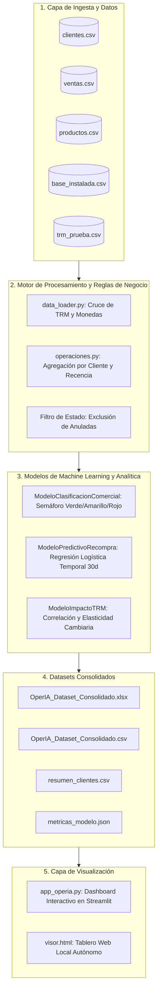

# 🧠 Arquitectura de la Solución y Modelos de Inteligencia Artificial

## 1. Diagrama de Arquitectura OperIA

---

## 2. Reglas de Negocio y Normalización Monetaria

### Cálculo de Ventas en Moneda Homogénea (COP)
Cada fila de ventas se calcula antes de impuestos según la fórmula:
$$\text{Importe Neto} = \text{Cantidad} \times \text{Precio Unitario} \times \left(1 - \frac{\text{Descuento \%}}{100}\right)$$

* **Moneda COP:** Se mantiene en pesos colombianos directamente.
* **Moneda USD:** Se multiplica por la tasa exacta de `trm_prueba.csv` correspondiente a la fecha de la transacción:
$$\text{Venta COP} = \text{Importe Neto (USD)} \times \text{TRM}_{\text{Fecha}}$$
* **Estado de Venta:** Solo las ventas con estado `Confirmada` suman al ingreso acumulado y a la frecuencia de compra. Las transacciones `Anulada` se aíslan con valor \$0 COP.

---

## 3. Modelo 1: Clasificador Comercial y Semáforo Inteligente

El semáforo traduce la complejidad de las fechas y contratos en una regla de decisión transparente y accionable para los asesores comerciales:

| Estado | Criterio Operacional | Prioridad de Llamada | Acción Comercial Recomendada |
| :--- | :--- | :--- | :--- |
| 🟢 **Frecuente (Activo)** | Días sin compra $\le 30$ o $\ge 8$ compras acumuladas. | MEDIA | Fidelización y propuesta de módulos adicionales (*up-selling*). |
| 🟡 **Base Instalada (Seguimiento)** | Días sin compra entre 31 y 89, o con contratos con renovación próxima ($\le 45$ días) o vencidos. | MEDIA-ALTA | Contactar para renovación anticipada de póliza o licencia de cobertura. |
| 🔴 **Frío (Riesgo de Abandono)** | Días sin compra $\ge 90$ días o sin historial de compra. | ALTA | Campaña de reactivación urgente con oferta personalizada. |

---

## 4. Modelo 2: Modelo Predictivo de Recompra a 30 Días

### Formulación del Problema
Predecir para cada cliente en una fecha de corte $t$, la probabilidad binaria ($Y \in \{0, 1\}$) de que realice al menos una compra confirmada dentro de la ventana de los siguientes 30 días naturales ($[t+1, t+30]$).

### Variables Predictoras (Features)
Para evitar cualquier fuga de información del futuro (*data leakage*), las variables se calculan utilizando **únicamente los datos observables hasta la fecha de corte $t$**:
1. `recencia_dias`: Días transcurridos desde la última compra confirmada hasta $t$.
2. `frecuencia_30d`: Número de transacciones confirmadas en los 30 días previos a $t$.
3. `frecuencia_90d`: Número de transacciones confirmadas en los 90 días previos a $t$.
4. `historial_n`: Total de compras confirmadas históricas del cliente hasta $t$.

### Partición Temporal Estricta
A diferencia de un muestreo aleatorio (que violaría el orden cronológico), se utilizó una partición temporal por bloques mensuales:
* **Entrenamiento (Train):** Instantáneas mensuales desde marzo de 2025 hasta **abril de 2026**.
* **Validación (Validation):** Instantáneas de **mayo y junio de 2026** (utilizado exclusivamente para seleccionar el umbral óptimo de decisión).
* **Prueba Fuera de Tiempo (Out-Of-Time Test):** Instantáneas de **julio a septiembre de 2026** (la ventana de septiembre termina el 30 de octubre de 2026 y es completamente observable).

### Algoritmo y Optimización
Se implementó una **Regresión Logística Regularizada (L2)** con estandarización de variables z-score $(\mu, \sigma)$ y optimización por Descenso de Gradiente:
$$P(Y=1 | \mathbf{x}) = \sigma(\mathbf{w}^T \tilde{\mathbf{x}}) = \frac{1}{1 + e^{-(\mathbf{w}^T \tilde{\mathbf{x}})}}$$

El umbral de clasificación óptimo ($\theta^* = 0.4$) fue seleccionado maximizando el **F1-Score** en el conjunto de validación.

### Resultados y Comparación con Línea Base

| Métrica en Prueba (Test) | Línea Base (Regla: Compra en últimos 30d) | Modelo Predictivo OperIA (ML) | Mejora Obtenida |
| :--- | :---: | :---: | :---: |
| **F1-Score** | 0.5743 | **0.6592** | **+14.8%** |
| **Recall (Exhaustividad)** | 56.7% | **78.0%** | **+37.6%** |
| **Precisión** | 58.2% | **57.1%** | Equilibrada |
| **Capacidad de Anticipación** | Baja (espera a que el cliente ya haya comprado) | **Alta** (detecta probabilidad real antes de la compra) | **Proactiva** |

> *Conclusión:* El modelo de IA incrementa notablemente el Recall (captura el 78% de todos los clientes que efectivamente volverán a comprar), reduciendo los falsos negativos y permitiendo anticiparse a la demanda.

---

## 5. Modelo 3: Modelo de Sensibilidad e Impacto de la TRM

### Metodología
Cruce mensual de la facturación agregada en COP frente al promedio de la tasa de cambio diaria:
$$\text{Ventas\_COP}_m = \alpha + \beta \cdot \overline{\text{TRM}}_m + \epsilon_m$$

### Hallazgos
* **Correlación de Pearson ($r$):** $+0.4736$ (Correlación positiva moderada-fuerte).
* **Interpretación Financiera:** Al existir contratos y productos indexados en dólares (USD), los periodos de devaluación del peso (alza en la TRM) incrementan la facturación nominal en COP. El panel interactivo permite a la Gerencia Financiera y a Operaciones simular y visualizar estos escenarios.
