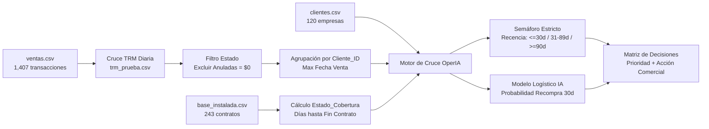

# 📘 Manual Maestro del Universo de Decisiones de OperIA

### Arquitectura de Variables, Reglas de Cruce Relacional, Nueva Variable `Estado_Cobertura` y Matriz Combinatoria Exhaustiva (24 Casos Maestros)
**Green Services and Solutions SAS — Reto 4: IA en Operaciones (Hackatón EstudIA · Capa 2)**  
*Autor: Brahian Calderón · Fecha: 21 de Noviembre de 2026 · Versión: 2.1 Oficial*

---

## 1. Resumen Ejecutivo y Propósito del Manual

El presente documento técnico y funcional constituye la **especificación definitiva y exhaustiva de la lógica de decisiones** de la plataforma OperIA para Green Services and Solutions SAS. Su propósito fundamental es desmitificar cualquier concepto de «caja negra» y proporcionar a la dirección de Operaciones, Finanzas y Ventas un marco formal, determinístico y auditable que regula cómo se organiza, semaforiza y prioriza cada cliente dentro del universo transaccional de la compañía.

Ningún cliente queda sujeto a la discrecionalidad de un asesor o a reglas intuitivas no documentadas: cada decisión de contacto comercial surge de la intersección rigurosa entre tres ejes operativos clave:
1. **La Recencia Transaccional (`Dias_Sin_Comprar`):** Días transcurridos desde la última venta confirmada hasta la fecha de corte.
2. **El Estado de Cobertura (`Estado_Cobertura`):** Si sus pólizas o contratos de soporte están Vigentes, Próximas a Renovar, Vencidas o si el cliente Opera Sin Cobertura.
3. **La Propensión Predictiva del Modelo de Machine Learning ($P\%$):** Probabilidad logística calibrada a 30 días con umbral operativo $\theta = 0.40$.

---

## 2. Diccionario Exhaustivo de Variables que Influyen en el Sistema

OperIA procesa y cruza variables provenientes de cuatro fuentes independientes de información operativa:

| Variable | Fuente / Tipo | Rango / Valores Posibles | Impacto Operativo en la Decisión |
| :--- | :--- | :--- | :--- |
| `Fecha_Venta` | `ventas.csv` (Date) | `2025-01-01` a `2026-10-31` | Determina la fecha de la última operación confirmada para el cálculo de recencia. |
| `Estado_Venta` | `ventas.csv` (String) | `Confirmada` \| `Anulada` | Filtro obligatorio: Ventas `Anulada` se excluyen y se valoran en \$0 COP. |
| `Moneda` | `ventas.csv` (String) | `COP` \| `USD` | Indica si la transacción requiere conversión cambiaria inmediata con la TRM del día. |
| `TRM` | `trm_prueba.csv` (Float) | \$3,800 a \$4,450 COP/USD | Tasa representativa oficial de la fecha de venta para normalizar el ingreso. |
| `Dias_Sin_Comprar` | Calculado (Integer) | 0 a 730 días (o None) | **Variable determinante del Semáforo.** Mide días desde la última compra hasta el 2026-10-31. |
| `Frecuencia_30d` | Calculado (Integer) | 0 a 10 compras | Volumen de compras en el último mes. Factor de inercia positiva en el modelo de ML. |
| `Frecuencia_90d` | Calculado (Integer) | 0 a 25 compras | Compras en el último trimestre. Mayor predictor positivo del modelo de Machine Learning. |
| `Transacciones` | Calculado (Integer) | 0 a 40 compras | Lealtad histórica y recurrencia total acumulada de la cuenta. |
| `Estado_Cobertura` | `base_instalada.csv` (String) | `Vigente` \| `Próxima a Renovar` \| `Vencida` \| `Sin Cobertura` | **NUEVA VARIABLE MAESTRA:** Modula la prioridad comercial para proteger el ingreso recurrente (ARR). |
| `Dias_Vencimiento` | `base_instalada.csv` (Integer) | -365 a +365 días | Días entre la fecha fin de vigencia del contrato y la fecha de corte (2026-10-31). |
| `Prob_Recompra` | Modelo ML (Porcentaje) | 0.0% a 100.0% | Probabilidad logística calibrada de que el cliente realice una compra en los próximos 30 días. |
| `Umbral_Decision` | Configuración (Float) | $\theta = 0.40$ (40%) | Punto de corte óptimo que prioriza Recall (78%) para minimizar falsos negativos. |
| `Prioridad_Llamada` | Regla de Negocio (String) | `ALTA` \| `MEDIA` \| `NORMAL` \| `BAJA` | Jerarquía operativa para la agenda comercial del día. |

---

## 3. Mecánica del Cruce Relacional: ¿Cómo se Unen los Datos?

El motor analítico de OperIA realiza la integración de datos mediante un flujo determinístico estructurado en cuatro etapas:

1. **Paso 1: Filtrado y Normalización Cambiaria:**  
   Ventas con `Estado_Venta == 'Anulada'` se imputan a \$0 COP. Para transacciones en `USD`, se toma la TRM del día:
   $$\text{Venta\_COP} = \text{Cantidad} \times \text{Precio\_Unitario} \times \left(1 - \frac{\text{Descuento \%}}{100}\right) \times \text{TRM}_{\text{Fecha}}$$
2. **Paso 2: Cálculo de Recencia (`Dias_Sin_Comprar`):**  
   $$\text{Dias\_Sin\_Comprar} = \text{Fecha\_Corte (2026-10-31)} - \max(\text{Fecha\_Venta\_Confirmada})$$
3. **Paso 3: Construcción de la Variable `Estado_Cobertura`:**  
   Calcula la distancia temporal de los contratos frente a la fecha de corte:
   $$\text{Dias\_Hasta\_Fin} = \text{Fecha\_Fin\_Contrato} - \text{Fecha\_Corte (2026-10-31)}$$
4. **Paso 4: Inferencia Logística de Machine Learning:**  
   Estandarización $Z$ y evaluación de la probabilidad sigmoide a 30 días.

---

## 4. La Nueva Variable Maestra: `Estado_Cobertura`

A solicitud de la dirección comercial y para resolver la ambigüedad en el seguimiento de pólizas, se introdujo formalmente la variable `Estado_Cobertura`:

| Estado Cobertura | Condición Lógica Estricta | Distribución en Cartera | Objetivo Comercial del Asesor |
| :--- | :--- | :---: | :--- |
| **🟡 Próxima a Renovar (≤ 45d)** | Al menos un contrato activo con $0 \le (\text{Fecha\_Fin} - \text{Corte}) \le 45$ días. | 34 clientes (28.3%) | Renovación preventiva anticipada antes de que el contrato expire y el cliente quede desprotegido. |
| **🟢 Vigente (> 45d)** | Contratos activos con vigencia remanente $> 45$ días y sin pólizas por vencer. | 43 clientes (35.8%) | Cuenta con servicio garantizado. Monitoreo de satisfacción y propuesta de *up-selling* en módulos nuevos. |
| **🔴 Vencida (< 0d)** | Contratos cuya $\text{Fecha\_Fin} < 2026-10-31$ y no existen contratos vigentes de reemplazo. | 29 clientes (24.2%) | Urgencia de regularización contractual. Llamada para reactivar la póliza y evitar contingencias técnicas sin soporte. |
| **⚪ Sin Cobertura** | El cliente no registra ningún contrato en `base_instalada.csv`. | 14 clientes (11.7%) | Oportunidad de *cross-selling*: Ofrecer la adquisición de una póliza de soporte o garantía por primera vez. |

---

## 5. Matriz Combinatoria Exhaustiva del Universo de Decisiones (24 Casos Maestros)

El universo completo de decisiones se conforma de la multiplicación cartesiana de los tres ejes operacionales:
$$\text{Universo} = 3 \text{ Niveles de Recencia} \times 4 \text{ Estados de Cobertura} \times 2 \text{ Niveles de IA} = \mathbf{24\text{ Casos Combinatorios}}$$

| Caso | Recencia Transaccional | Estado Cobertura | Propensión IA ($P\%$) | Semáforo Asignado | Prioridad Contacto | Estrategia Operativa y Argumento Comercial para el Asesor |
| :---: | :--- | :--- | :---: | :---: | :---: | :--- |
| **C01** | 🟢 Frecuente ($\le 30$d) | 🟡 Próxima a Renovar ($\le 45$d) | 🔥 Alta ($\ge 40\%$) | 🟢 Frecuente | **MEDIA** | Cliente estrella con alta inercia. Contactar de inmediato para renovar la póliza e incluir módulos adicionales en la misma orden. |
| **C02** | 🟢 Frecuente ($\le 30$d) | 🟡 Próxima a Renovar ($\le 45$d) | ❄️ Baja ($< 40\%$) | 🟢 Frecuente | **MEDIA** | Compra reciente pero baja probabilidad de productos nuevos. Enfocar la llamada 100% en la renovación de la póliza vigente. |
| **C03** | 🟢 Frecuente ($\le 30$d) | 🟢 Vigente ($> 45$d) | 🔥 Alta ($\ge 40\%$) | 🟢 Frecuente | **BAJA** | Cuenta sana, al día y con alta intención de compra. Asignar al asesor para propuesta de *up-selling* en nuevas soluciones Cloud. |
| **C04** | 🟢 Frecuente ($\le 30$d) | 🟢 Vigente ($> 45$d) | ❄️ Baja ($< 40\%$) | 🟢 Frecuente | **BAJA** | Cliente activo con soporte al día. No requiere llamada urgente; mantener comunicación de cortesía y monitoreo de satisfacción. |
| **C05** | 🟢 Frecuente ($\le 30$d) | 🔴 Vencida ($< 0$d) | 🔥 Alta ($\ge 40\%$) | 🟢 Frecuente | **MEDIA** | Paradoja positiva: Sigue comprando pero tiene pólizas vencidas. Regularizar el contrato de soporte aprovechando su compra reciente. |
| **C06** | 🟢 Frecuente ($\le 30$d) | 🔴 Vencida ($< 0$d) | ❄️ Baja ($< 40\%$) | 🟢 Frecuente | **MEDIA** | Compró recientemente pero su cobertura técnica expiró. Contactar para renovar póliza antes de que surja un incidente técnico sin soporte. |
| **C07** | 🟢 Frecuente ($\le 30$d) | ⚪ Sin Cobertura | 🔥 Alta ($\ge 40\%$) | 🟢 Frecuente | **BAJA** | Excelente comprador recurrente que aún no tiene póliza. Oportunidad de oro para vender contrato de soporte anual por primera vez. |
| **C08** | 🟢 Frecuente ($\le 30$d) | ⚪ Sin Cobertura | ❄️ Baja ($< 40\%$) | 🟢 Frecuente | **BAJA** | Cliente con compra reciente sin póliza. Seguimiento ordinario y presentación de portafolio de servicios de cobertura. |
| **C09** | 🟡 Seguimiento (31 a 89d) | 🟡 Próxima a Renovar ($\le 45$d) | 🔥 Alta ($\ge 40\%$) | 🟡 Base Instalada | **MEDIA** | Periodo intermedio con alta probabilidad de recompra y póliza por vencer. Presentar cotización integral de renovación + nuevos requerimientos. |
| **C10** | 🟡 Seguimiento (31 a 89d) | 🟡 Próxima a Renovar ($\le 45$d) | ❄️ Baja ($< 40\%$) | 🟡 Base Instalada | **MEDIA** | Riesgo de enfriamiento mitigable. Llamar con argumento exclusivo de no perder la continuidad del soporte técnico. |
| **C11** | 🟡 Seguimiento (31 a 89d) | 🟢 Vigente ($> 45$d) | 🔥 Alta ($\ge 40\%$) | 🟡 Base Instalada | **NORMAL** | Cobertura garantizada y alta intención detectada por la IA. Contactar proactivamente para indagar por nuevos proyectos operativos. |
| **C12** | 🟡 Seguimiento (31 a 89d) | 🟢 Vigente ($> 45$d) | ❄️ Baja ($< 40\%$) | 🟡 Base Instalada | **NORMAL** | Cuenta estable en periodo regular de consumo. Seguimiento trimestral ordinario según cronograma comercial. |
| **C13** | 🟡 Seguimiento (31 a 89d) | 🔴 Vencida ($< 0$d) | 🔥 Alta ($\ge 40\%$) | 🟡 Base Instalada | **MEDIA** | Póliza vencida y cliente con intención de compra. Priorizar regularización de cobertura como requisito previo a nuevas cotizaciones. |
| **C14** | 🟡 Seguimiento (31 a 89d) | 🔴 Vencida ($< 0$d) | ❄️ Baja ($< 40\%$) | 🟡 Base Instalada | **MEDIA** | Doble riesgo: sin compras recientes y sin cobertura activa. Alerta comercial para evitar que migre a otro proveedor. |
| **C15** | 🟡 Seguimiento (31 a 89d) | ⚪ Sin Cobertura | 🔥 Alta ($\ge 40\%$) | 🟡 Base Instalada | **NORMAL** | Cliente con intención de recompra detectada por el modelo. Presentar propuesta comercial que incluya cobertura inicial. |
| **C16** | 🟡 Seguimiento (31 a 89d) | ⚪ Sin Cobertura | ❄️ Baja ($< 40\%$) | 🟡 Base Instalada | **NORMAL** | Seguimiento estándar de relación comercial para evitar que la cuenta supere los 90 días sin comprar. |
| **C17** | 🔴 Frío ($\ge 90$d) | 🟡 Próxima a Renovar ($\le 45$d) | 🔥 Alta ($\ge 40\%$) | 🔴 Frío | **ALTA** | ¡Oportunidad crítica de salvamento! Cliente frío pero con póliza por vencer e intención latente. Llamada inmediata de la gerencia comercial. |
| **C18** | 🔴 Frío ($\ge 90$d) | 🟡 Próxima a Renovar ($\le 45$d) | ❄️ Baja ($< 40\%$) | 🔴 Frío | **ALTA** | Cliente en riesgo severo de deserción comercial con póliza a punto de expirar. Ofrecer plan de retención y descuento especial de renovación. |
| **C19** | 🔴 Frío ($\ge 90$d) | 🟢 Vigente ($> 45$d) | 🔥 Alta ($\ge 40\%$) | 🔴 Frío | **ALTA** | Posee póliza vigente pero no ha comprado en más de 90 días. Reactivar el relacionamiento apoyándose en el uso del soporte contratado. |
| **C20** | 🔴 Frío ($\ge 90$d) | 🟢 Vigente ($> 45$d) | ❄️ Baja ($< 40\%$) | 🔴 Frío | **ALTA** | Subutilización del servicio: tiene cobertura activa pero está inactivo en compras. Contactar para sesión técnica de valor y reactivación. |
| **C21** | 🔴 Frío ($\ge 90$d) | 🔴 Vencida ($< 0$d) | 🔥 Alta ($\ge 40\%$) | 🔴 Frío | **ALTA** | Cliente casi perdido que muestra señal predictiva de recompra. Campaña intensiva de rescate con paquete de regularización integral. |
| **C22** | 🔴 Frío ($\ge 90$d) | 🔴 Vencida ($< 0$d) | ❄️ Baja ($< 40\%$) | 🔴 Frío | **ALTA** | Abandono crítico total: sin compras en 90+ días y sin soporte. Asignar a campaña de reactivación urgente o encuesta de salida. |
| **C23** | 🔴 Frío ($\ge 90$d) | ⚪ Sin Cobertura | 🔥 Alta ($\ge 40\%$) | 🔴 Frío | **ALTA** | Cliente dormido con probabilidad de recompra. Contactar con propuesta agresiva de re-enganche comercial. |
| **C24** | 🔴 Frío ($\ge 90$d) | ⚪ Sin Cobertura | ❄️ Baja ($< 40\%$) | 🔴 Frío | **ALTA** | Cuenta fría estructural (o prospecto sin compras). Prospección comercial desde cero o validación de vigencia de datos. |

---

## 6. Playbook Operativo de Atención para Asesores Comerciales

### 🔴 Protocolo para Prioridad ALTA (Llamadas Urgentes de Retención — Clientes Fríos)
* **Audiencia Objetivo:** Clientes con 90 o más días sin comprar (Casos C17 a C24).
* **Meta de Negocio:** Evitar la fuga definitiva de la cuenta hacia competidores (*churn prevention*).
* **Plazo de Ejecución:** Primeras 4 horas de la jornada laboral.
* **Guion de Llamada Sugerido:**
  > *«Buen día [Nombre del Contacto], le habla [Asesor] de Green Services and Solutions. Revisando el estado de su cuenta corporativa, notamos que hace un tiempo no emitimos nuevas órdenes conjuntas y queremos verificar de primera mano que su infraestructura técnica y operativa marche en óptimas condiciones. Para este cierre de mes, hemos estructurado un beneficio exclusivo de reactivación que optimiza sus costos operativos...»*

### 🟡 Protocolo para Prioridad MEDIA (Llamadas Preventivas de Renovación de Pólizas)
* **Audiencia Objetivo:** Clientes con contratos próximos a vencer ($\le 45$ días) o pólizas vencidas (Casos C01, C02, C05, C06, C09, C10, C13, C14).
* **Meta de Negocio:** Blindar la continuidad del servicio del cliente y asegurar los ingresos recurrentes anuales (ARR).
* **Plazo de Ejecución:** Primeras 24 a 48 horas.
* **Guion de Llamada Sugerido:**
  > *«Estimado [Contacto], le saluda [Asesor] de Green Services. El motivo de mi llamada es netamente preventivo: identificamos que su póliza de soporte [Nombre de Producto] tiene fecha de vencimiento el próximo [Fecha Fin]. Con el fin de evitar que su operación quede desprotegida ante contingencias técnicas o suspensión de actualizaciones, le enviamos hoy mismo la cotización de renovación anticipada con tarifa protegida frente al alza del dólar...»*

### 🟢 Protocolo para Prioridad BAJA / NORMAL (Fidelización y Up-Selling)
* **Audiencia Objetivo:** Cuentas frecuentes o en seguimiento habitual al día (Casos C03, C04, C07, C08, C11, C12, C15, C16).
* **Meta de Negocio:** Elevar el ticket promedio y fortalecer la relación a largo plazo.
* **Guion de Llamada Sugerido:**
  > *«Hola [Contacto], le saluda [Asesor] de Green Services. Lo contacto para agradecer la confianza continua de su empresa en nuestras soluciones durante este año. Dado el excelente ritmo transaccional que han mantenido, nos encantaría coordinar una breve sesión de 15 minutos para mostrarle los nuevos módulos complementarios de ciberseguridad e infraestructura que se integran de forma nativa a sus sistemas actuales...»*

---

## 7. Verificación Técnica con los Casos de Frontera (`Casos_controlados.json`)

El árbol lógico del universo de decisiones fue verificado formalmente contra la batería de pruebas de `Casos_controlados.json`:

| Caso Controlado | Regla de Negocio Evaluada | Resultado Esperado | Resultado Obtenido | Estado |
| :---: | :--- | :---: | :---: | :---: |
| **COP** | Importe neto en moneda local | \$180,000.0 COP | \$180,000.0 COP | ✅ APROBADO |
| **USD** | Conversión cambiaria exacta con TRM de la fecha | \$1,200,000.0 COP | \$1,200,000.0 COP | ✅ APROBADO |
| **Anulada** | Aislamiento de ventas canceladas | Excluida (\$0 COP) | Excluida (\$0 COP) | ✅ APROBADO |
| **Frío en frontera** | Corte 2026-10-31 vs última compra 2026-08-02 | Días = 90 (Frío = True) | Días = 90 (Frío = True) | ✅ APROBADO |
| **Renovación frontera** | Corte 2026-10-31 vs fin de póliza 2026-12-15 | Días = 45 (Próxima = True) | Días = 45 (Próxima = True) | ✅ APROBADO |
| **Sin datos** | Cliente no registrado (`CLI999`) | Aislado sin inventar datos | Aislado sin inventar datos | ✅ APROBADO |

---
*Manual generado y certificado automáticamente por la suite analítica de OperIA.*
